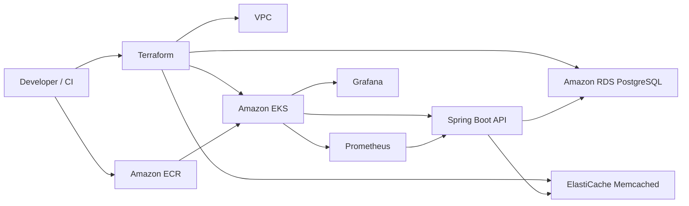

# AWS Java Observability Platform

A deployable Java/Spring Boot project for AWS with:

- Spring Boot 3 REST API
- React dashboard frontend
- PostgreSQL on Amazon RDS
- Memcached on Amazon ElastiCache
- Container image published to Amazon ECR
- Runtime deployment on Amazon EKS
- Infrastructure managed by Terraform
- Kubernetes deployment packaged as a Helm chart
- Prometheus metrics via Micrometer
- Grafana dashboards via `kube-prometheus-stack`

## Architecture



## Repository Layout

```text
.
├── app/                  # Spring Boot application
├── frontend/             # React dashboard application
├── docker/               # Container image definition
├── helm/                 # Helm chart for the application
├── terraform/            # AWS infrastructure
├── monitoring/           # Grafana dashboard examples
└── .github/workflows/    # CI and deployment workflow examples
```

## Prerequisites

- Java 21
- Gradle 8.10+
- Docker
- Terraform 1.7+
- AWS CLI configured with credentials
- kubectl
- Helm 3

## Local Development

```bash
docker compose up -d postgres memcached
cd app
gradle bootRun
```

In another terminal:

```bash
cd frontend
npm install
npm run dev
```

Open `http://localhost:5173`. The React dev server proxies `/api` and `/actuator` to the Spring Boot service on port `8080`.

You can also run the full containerized stack:

```bash
docker compose up --build
```

The frontend is then available at `http://localhost:5173`.

The app starts with in-memory-friendly defaults and exposes:

- `GET /api/notes`
- `POST /api/notes`
- `GET /api/cache/{key}`
- `PUT /api/cache/{key}`
- `GET /actuator/health`
- `GET /actuator/prometheus`

The React frontend includes:

- API health overview
- request-rate and latency dashboard
- EKS, RDS, ElastiCache, Prometheus, and Terraform service map
- notes UI backed by `POST /api/notes`
- cache write UI backed by `PUT /api/cache/{key}`

## Deploy Infrastructure

```bash
cd terraform/envs/dev
terraform init
terraform plan -out tfplan
terraform apply tfplan
```

Terraform provisions:

- VPC with public, private, and database subnets
- EKS cluster with managed node group
- ECR repository
- RDS PostgreSQL instance
- ElastiCache Memcached cluster
- `kube-prometheus-stack` Helm release

## Build And Push Image

After Terraform creates ECR, use the `ecr_repository_url` and `frontend_ecr_repository_url` outputs:

```bash
AWS_ACCOUNT_ID=$(aws sts get-caller-identity --query Account --output text)

aws ecr get-login-password --region us-east-1 \
  | docker login --username AWS --password-stdin "$AWS_ACCOUNT_ID.dkr.ecr.us-east-1.amazonaws.com"

docker build -f docker/Dockerfile -t "$(terraform -chdir=terraform/envs/dev output -raw ecr_repository_url):latest" .
docker push "$(terraform -chdir=terraform/envs/dev output -raw ecr_repository_url):latest"

docker build -f docker/frontend.Dockerfile -t "$(terraform -chdir=terraform/envs/dev output -raw frontend_ecr_repository_url):latest" .
docker push "$(terraform -chdir=terraform/envs/dev output -raw frontend_ecr_repository_url):latest"
```

## Deploy App To EKS

```bash
aws eks update-kubeconfig --region us-east-1 --name java-observability-dev

helm upgrade --install java-api ./helm/java-api \
  --namespace java-api \
  --create-namespace \
  --set image.repository=<ecr_repository_url> \
  --set image.tag=latest \
  --set env.DB_HOST=<rds_endpoint> \
  --set env.DB_NAME=appdb \
  --set env.DB_USERNAME=appuser \
  --set env.DB_PASSWORD=<password> \
  --set env.MEMCACHED_HOST=<memcached_endpoint>

helm upgrade --install frontend ./helm/frontend \
  --namespace java-api \
  --create-namespace \
  --set image.repository=<frontend_ecr_repository_url> \
  --set image.tag=latest
```

For production, store secrets in AWS Secrets Manager or External Secrets Operator instead of passing them on the command line.

## Monitoring

The Helm chart can create a `ServiceMonitor` for Prometheus Operator:

```bash
helm upgrade --install java-api ./helm/java-api \
  --namespace java-api \
  --create-namespace \
  --set serviceMonitor.enabled=true
```

Grafana is installed by Terraform through `kube-prometheus-stack`. Import the dashboard from `monitoring/grafana/java-api-dashboard.json`.

## CI/CD

`.github/workflows/ci.yml` builds and tests the Java app.

`.github/workflows/deploy.yml` shows a deployment pipeline using GitHub OIDC, ECR, EKS, and Helm. Fill in the repository variables described in the workflow before using it.

## Notes

This project is intentionally practical but still a starter. Before using it for production, review:

- RDS backup, encryption, maintenance, and high availability settings
- Fine-grained IAM policies
- Externalized secret management
- Network ingress strategy such as AWS Load Balancer Controller
- Autoscaling policies and resource sizing
- Log shipping to CloudWatch, OpenSearch, or another log backend
